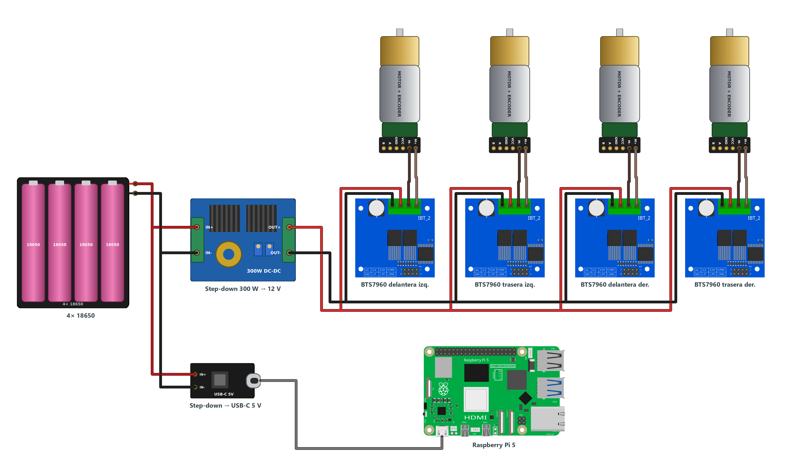
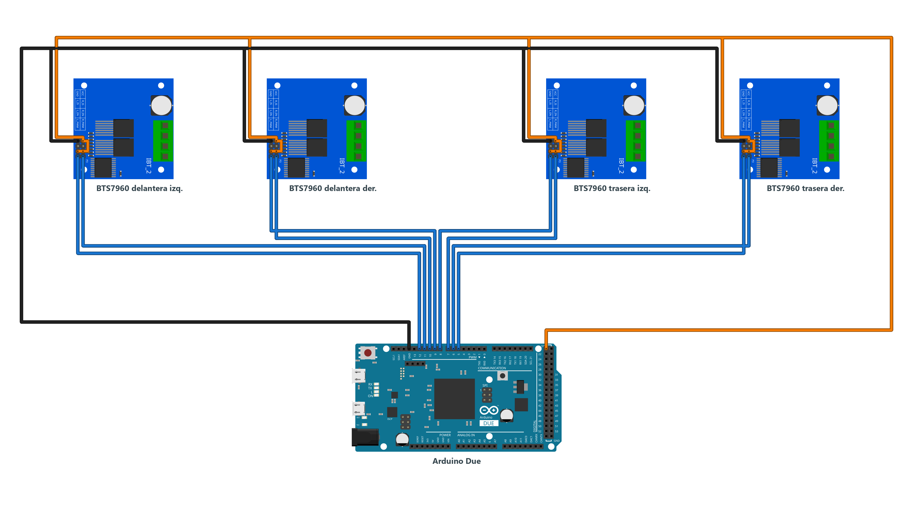
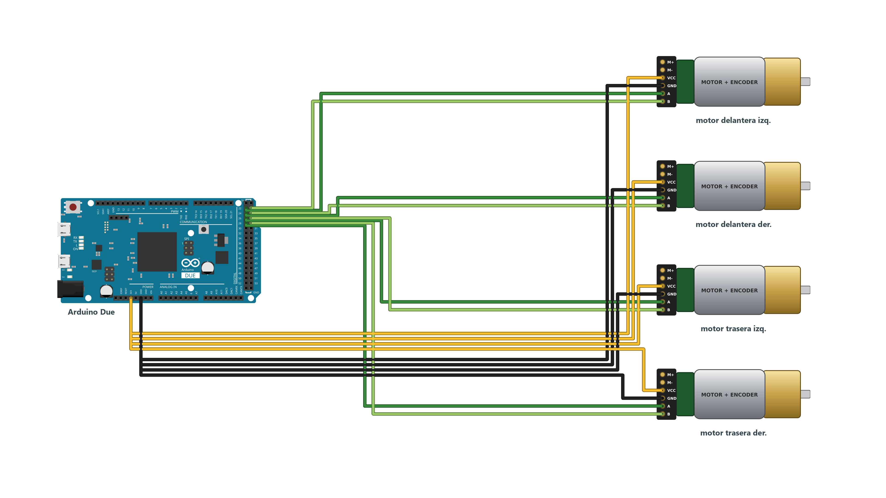
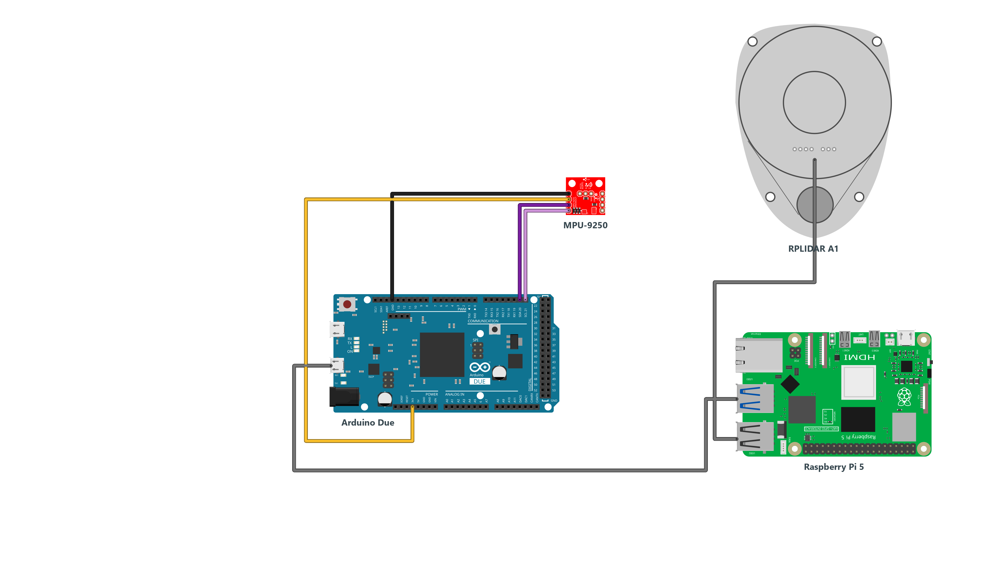

# auto4wd — un auto 4WD que mapea con un RPLIDAR

*[Read in English](README.md)*

Un auto pequeño de tracción en las cuatro ruedas, sin dirección (skid-steer), que manejas con un DualShock 4 mientras
construye en tiempo real un mapa 2D del lugar.
- Un Arduino Due mueve los cuatro motores y lee los cuatro encoders de cuadratura y el giroscopio.
- Una Raspberry Pi 5 con ROS 2 Jazzy convierte eso en odometría y se la entrega a `slam_toolbox` junto con un RPLIDAR A1.
- Todo se transmite a [Foxglove](https://foxglove.dev) en el PC.

Es un proyecto personal, no un producto. No navega solo: tú lo manejas y el mapa se dibuja.

## Piezas

| Pieza | Para qué |
| --- | --- |
| Chasis 4WD y 4 motorreductores DC con encoder incremental de cuadratura | ruedas de 65 mm, 994 cuentas por vuelta (decodificación ×4), trocha de 215 mm |
| 4 puentes H BTS7960 | uno por rueda; IN1/IN2 los dos con PWM (el sentido lo da cuál de los dos lleva el PWM) |
| Step-down de 300 W | batería → 12 V para los motores |
| Step-down con salida USB-C | batería → 5 V para la Raspberry Pi |
| 4 pilas 18650 de litio (Samsung INR18650, 2600 mAh) | el pack de batería |
| Arduino Due | motores, encoders (8 pines con interrupción: por eso el Due) e IMU |
| IMU MPU-9250 por I²C | el giroscopio Z da la rotación (al girar, las ruedas patinan y los encoders mienten) |
| Raspberry Pi 5 (8 GB), Ubuntu 24.04 + ROS 2 Jazzy | nodo de odometría, driver del lidar, SLAM y puente de Foxglove |
| RPLIDAR A1M8 (con su adaptador USB-serie CP2102) | barridos láser de 360° a ~8 Hz |
| DualShock 4 por Bluetooth | para manejar |

**Regla de oro:** motores y computador nunca comparten el riel de alimentación. Con un riel común, el pico de
arranque de los cuatro motores hunde el voltaje y la Pi se reinicia apenas aceleras.

## Cableado

Cuatro diagramas, uno por subsistema (PNG + `.fzz` de Fritzing en [`docs/cableado/`](docs/cableado/)):

| | |
| --- | --- |
|  | **Energía** — pack 4×18650 → step-down de 300 W (12 V) → los cuatro BTS7960 → motores; un segundo step-down con salida USB-C alimenta la Pi |
|  | **Motores** — dos pines PWM por rueda (adelante / atrás) del Due a cada BTS7960; 5 V, GND y los dos enable |
|  | **Encoders** — canales A/B de los cuatro motores en los pines 22–29 del Due |
|  | **Sensores** — MPU-9250 por I²C (pines 20/21); el Due y el lidar van a la Pi por USB |

Asignación de pines (de `teleop_due/teleop_due.ino`):

| Rueda | PWM {atrás, adelante} | Encoder (A, B) |
| --- | --- | --- |
| delantera izquierda | 12, 11 | 22, 23 |
| trasera izquierda | 8, 7 | 26, 27 |
| delantera derecha | 9, 10 | 24, 25 |
| trasera derecha | 5, 6 | 28, 29 |

## Software

```
DS4 --BT--> Raspberry Pi 5 (teleop_ros.py: mando + odometría) --USB serie--> Arduino Due (teleop_due.ino)
RPLIDAR A1 --USB--> Raspberry Pi 5 (rplidar_ros) --> slam_toolbox --> /map
foxglove_bridge (ws://<robot>.local:8765) --> Foxglove en el PC
```

| Ruta | Contenido |
| --- | --- |
| `teleop_due/` | firmware del Due: PWM por rueda, encoders decodificados **por muestreo a 20 kHz** con un temporizador, giroscopio por **I²C de software** (bit-bang), watchdog de 300 ms, telemetría `T fl rl fr rr yaw_mrad gz_mrad_s` a 10 Hz |
| `ros/teleop_ros.py` | nodo ROS 2: mando → `V <izq> <der>` al Due; odometría (`/odom`, TF) con la distancia de los encoders y la rotación del giroscopio; tópico de diagnóstico `/ruedas` |
| `ros/mapper.sh`, `ros/mapper.service` | lanzador systemd: lidar (con reintentos y vigilante), nodo de odometría, `slam_toolbox` (activación lifecycle con reintentos), `foxglove_bridge` |
| `ros/slam_params.yaml` | parámetros de `slam_toolbox` (celdas de 5 cm, mapa cada 0,5 s) |
| `ros/layout_robot.json` | layout de Foxglove: panel 3D con `/map`, `/scan` y `/odom`, cámara siguiendo al auto |
| `ros/50-cloud-init.yaml`, `ros/network-config` | ejemplo de netplan con WiFi de la casa + hotspot del celular (valores de ejemplo) |
| `rpi/odom_encoders.py` | nodo de demostración: odometría solo con encoders en `/odom_enc`, para compararla con el giroscopio |
| `rpi/` (resto) | diagnóstico: volcar el mapa a PGM, scan sobre el mapa, prueba de orientación del lidar, consola serie, prueba en línea recta |
| `mapeo_encoders/`, `i2c_*`, `imu_diag/`, `test_blink/` | sketches de puesta en marcha: mapeo rueda↔encoder, escáneres I²C, diagnóstico del IMU |
| `analiza2m.py`, `MAPEO_RESULTADO.md` | análisis de la calibración de odometría y tabla de pines ruedas/encoders |

### Compilar y flashear el Due

La Pi no compila para el Due: se compila en el PC y se flashea desde la Pi.

```bash
arduino-cli compile --fqbn arduino:sam:arduino_due_x_dbg teleop_due --output-dir build_teleop
# en la Pi (antes: sudo systemctl stop mapper)
stty -F /dev/ttyACM0 1200; sleep 2.5
~/BOSSA/bin/bossac --port=ttyACM0 -U false -e -w -v -b teleop_due.ino.bin -R
```

Usa `bossac` **1.6.1-arduino** (`git clone -b arduino https://github.com/arduino/BOSSA && make bin/bossac`).
El `bossac` 1.9 de los repositorios de Ubuntu dice «Verify successful», pero el Due nunca arranca el programa.

### Raspberry Pi

```bash
sudo apt install ros-jazzy-ros-base ros-jazzy-slam-toolbox ros-jazzy-rplidar-ros \
                 ros-jazzy-foxglove-bridge ros-jazzy-rmw-cyclonedds-cpp
mkdir -p ~/teleop && cp ros/{mapper.sh,teleop_ros.py,slam_params.yaml} ~/teleop/
sudo cp ros/mapper.service /etc/systemd/system/ && sudo systemctl enable --now mapper
```

Después, en Foxglove: *Open connection* → *Foxglove WebSocket* → `ws://<robot>.local:8765`, e importa
`ros/layout_robot.json`. Deja el auto quieto ~3 s al encenderlo (calibración del giroscopio).

**Controles (DS4):**

| Control | Acción |
| --- | --- |
| R2 | acelera |
| L2 | retrocede |
| stick izquierdo | dirección (gira en el lugar si no aceleras) |
| Círculo | freno |
| cruceta ↑/↓ | límite de velocidad (parte en 50 %) |

Maneja despacio al mapear: el A1 barre 360° en ~120 ms.

## Lo aprendido (los bugs que vale la pena conocer)

- **El lidar está montado girado 180°.** Su cero apunta hacia atrás.
  - Con `yaw = 0` en la transformada `base_link → laser`, el mapa salía en estrella aunque el giroscopio fuera perfecto.
  - Arreglo: `LASER_XY_YAW = (0, 0, 0.10, math.pi)`.
- **El motor del lidar saca al IMU del bus I²C**: 0 caídas en 45 s con el motor quieto, 24 con el motor girando.
  - El TWI de hardware del SAM3X quedaba colgado ~112 ms por transacción.
  - Arreglo en el firmware: habla con el IMU por I²C de software y recupera el bus con 10 pulsos de SCL + STOP.
  - En los huecos cortos, el nodo mantiene el rumbo.
- **Los encoders contaban ~7 % de menos**, en tres capas:
  - `digitalRead` lento en la interrupción;
  - el despachador de `attachInterrupt` del Due, que pierde flancos (de ahí el muestreo a 20 kHz);
  - una escala empírica de 1,0773 medida con huincha en 3 corridas de 2,10 m.
- **En skid-steer, los encoders mienten al girar.** La rotación sale del giroscopio y la distancia de los encoders.
- **«Tópicos fantasma» en ROS 2.**
  - Con `ROS_LOCALHOST_ONLY=1`, FastDDS no emparejaba a los suscriptores que llegaban tarde por loopback (además, `lo` no tenía el flag `MULTICAST`).
  - Se arregló cambiando a CycloneDDS.
  - Para hablar con el grafo por SSH, exporta el mismo `RMW_IMPLEMENTATION` y `CYCLONEDDS_URI` que `mapper.sh`.
- **`serial.write()` de pyserial puede bloquearse para siempre** cuando el CDC-ACM del Due se atasca. El nodo escribe con `O_NONBLOCK` + `os.write` y reabre el puerto tras varios `EAGAIN` seguidos.
- **`slam_toolbox` es un nodo lifecycle:** lanzado con `ros2 run` queda `unconfigured` hasta hacer `configure` + `activate`.
- **Usa siempre rutas `/dev/serial/by-id/`.** Tras un tropiezo del USB, el lidar volvió como `ttyUSB1`.
- **El SSID del hotspot del celular es el nombre del teléfono**, en este caso con un espacio al final. Los SSID se comparan byte a byte.

## Licencia

[MIT](LICENSE). Las ilustraciones del cableado usan piezas de la biblioteca de Fritzing: ver [NOTICE.md](NOTICE.md).
